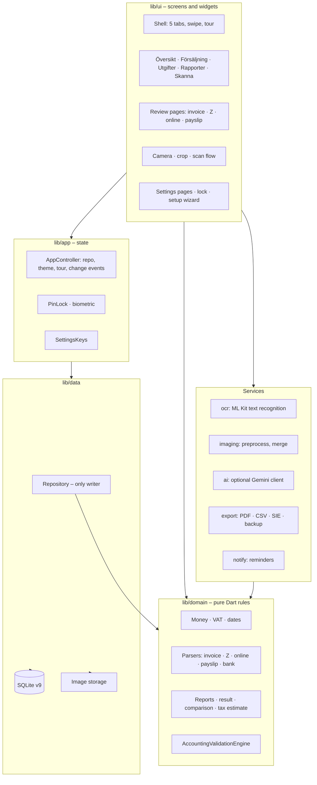
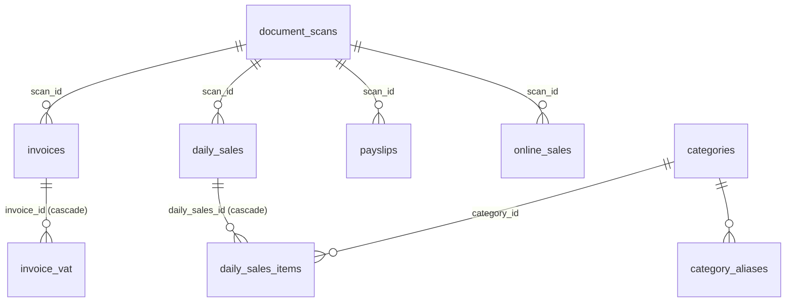

# 02 – Design document

Baseline: commit `8204b71`, release `v2026.11.13i`, database version 9.

## 1. Overview

Quee is a Flutter app (Dart SDK ^3.9) for Android. It has no server. The app reads a photographed or imported document on the device, proposes structured data, the user confirms it, and the data is stored in a local SQLite database. Reports, SIE files and backups are produced from that database.

About 21 000 lines of Dart in `lib/` (127 files) and about 4 700 lines in `test/` (37 files).

## 2. Architecture



**Dependency rule.** `domain` depends on nothing in the app (plain Dart, easy to test and to move to iOS later). `data` depends on `domain`. `ui` depends on everything below it. The `Repository` is the only code that writes to the database.

### 2.1 Modules

| Folder | Contents | Notes |
|---|---|---|
| `lib/domain` (27 files) | `money`, `vat`, `dates`, `models`, `validation`, `reports`, `result_report`, `comparison`, `tax_estimate`, `cost_types`, `license`, `classifier`, `document_parser`, `invoice_parser`, `z_report_parser`, `payslip_parser`, `online_parser`, `payment_detector`, `supplier_hints`, `bank_matcher`, `bank_statement`, `slip_code_line`, `text_patterns`, `text_merge`, `ocr_models`, `invoice_filter`, `category_templates` | No Flutter imports. All money rules and report maths live here. |
| `lib/data` (3) | `database.dart` (schema and upgrades), `repository.dart` (all reads and writes, audit log), `storage.dart` (image files) | Schema version 9 with step-wise `onUpgrade`. |
| `lib/app` (5) | `app_controller` (repository, theme mode, tour request, update check, change notifications), `app_update` (read the latest release, download, install), `pin_lock`, `biometric`, `settings_keys` | `AppScope` is an inherited notifier. |
| `lib/ocr` (1), `lib/imaging` (1) | ML Kit text recognition; preprocessing and quality checks | Device only. |
| `lib/ai` (2) | Optional Gemini client and result parsing | Off by default, user's own key, asks every time. |
| `lib/export` (5) | `monthly_pdf`, `table_export`, `sie_export`, `backup`, `auto_backup` | PDF through `pdf`/`printing`, SIE type 4, encrypted backup. |
| `lib/notify` (1) | Local reminders | Rebuilt on every data change. |
| `lib/ui` (50) | Screens in `ui/`, plus `lock/`, `reports/`, `review/`, `scan/`, `settings/`, `widgets/` | See 2.3. |

### 2.2 Technology

| Area | Choice | Why |
|---|---|---|
| Framework | Flutter (Dart ^3.9) | One codebase, Android first, iPhone later. |
| Database | `sqflite` | Small, local, no server. `sqflite_common_ffi` for tests on the build machine. |
| OCR | `google_mlkit_text_recognition` | On-device, free, no network. |
| Secure storage | `flutter_secure_storage` | PIN data, backup password, API key. |
| Biometrics | `local_auth` (needs `FlutterFragmentActivity`; patched in CI) | Fingerprint as an opt-in shortcut. |
| Backup | `cryptography`, `saf_util`, `saf_stream` | Encrypted file in a user-chosen folder (Storage Access Framework). |
| Documents | `pdf`, `printing`, `file_picker`, `share_plus`, `open_filex`, `receive_sharing_intent` | Export, import and share. |
| Reminders | `flutter_local_notifications`, `timezone` | Local, no internet. |
| Theme | Own `AppTheme` with light and dark palettes | See 5. |

### 2.3 UI structure

- `Shell` holds five destinations: Översikt, Försäljning, Skanna, Utgifter, Rapporter. A `PageView` lets the user swipe between the four data pages; Skanna is opened only from the bar. Pages are kept alive while swiped away.
- The bottom bar is a floating pill; `extendBody: true` lets pages scroll behind it, so every list reserves 112 px at the bottom.
- Review pages (`ui/review`) are the single place where extracted data becomes a record. Each has an "existing" mode for editing.
- `Reloading<T>` is the common loader: it reloads when `AppController.revision` changes (after any save, edit or delete).
- First-run tour: `ui/tour.dart` draws a dimmed overlay with a hole over a `GlobalKey` target and a text box.

## 3. Data design

### 3.1 Entity relationships



Other tables: `vat_rates`, `audit_log`, `z_ignored_labels`, `supplier_payment_kinds`, `supplier_hints`. Sixteen tables in total. Foreign keys are enforced (`PRAGMA foreign_keys = ON`).

### 3.2 Data rules

- **Money** is integer öre (`Money`); formatting and parsing of Swedish amounts live in `money.dart`.
- **Moms** rates are basis points; `VatRuleSet` versions the rules by date (6 % food from 2026-04-01; 12 % restaurant service). A category's rate is chosen by the user, never derived from its name.
- **Totals are never stored.** Reports derive every total from records, so they cannot drift.
- **Counting date:** `Invoice.bookingDate` is the due date when present, else the invoice date. Reports, lists, filters and SIE use it. Payslips count on the payout date.
- **Settings** are key/value pairs (`SettingsKeys`): theme, rounding, company form, fiscal start month, reminder settings, tax estimate, tour flag and others.
- **Audit log** records create, update, delete, paid and unpaid events with a time stamp.

### 3.3 Migrations

`Database.open` runs `onUpgrade` step by step (`oldVersion < 2` … `< 9`), each step idempotent (`CREATE TABLE IF NOT EXISTS`, `ALTER`). A customer can jump from any old version to the newest. A test that opens an old-version file and upgrades it is listed as gap G-3 in the test report.

## 4. Key flows

### 4.1 Scan to saved record

```mermaid
sequenceDiagram
  actor U as User
  participant Cam as Camera/Import
  participant Img as Preprocess
  participant OCR as ML Kit OCR
  participant Cls as Classifier
  participant Par as Parser
  participant Val as Validation
  participant Rev as Review page
  participant Rep as Repository
  U->>Cam: photograph or import
  Cam->>Img: image(s), corners adjusted
  Img->>OCR: cleaned image
  OCR->>Cls: text blocks and boxes
  Cls->>Par: document type
  Par->>Val: draft with confidence per field
  Val->>Rev: draft + checks
  opt checks fail and user allows
    Rev->>Rev: optional online reading (Gemini), same validation
  end
  U->>Rev: edit and tap "Godkänn och spara"
  Rev->>Rep: save (duplicate check first)
  Rep-->>Rev: id, audit entry, learn labels
```

Nothing is written before the user's tap. The duplicate check runs before saving and lets the user choose.

For every document type the parsed draft is given a doubt count (`doubtsOf` for Z-reports, `invoiceDoubts`, `onlineDoubts`, `payslipDoubts` in `reading_doubts.dart`). If there are any and the photo is tilted, the scan flow reads the photo again turned by the tilt ML Kit measured (both directions) and keeps the reading with fewer doubts (`_readAgain` in `scan_flow.dart`). Footer text (web addresses, page numbers) is cut out of rows before parsing, and look-alike characters in short names are folded when comparing with the owner's categories.

### 4.2 Reports and SIE

`ReportGenerator` (monthly, yearly) and `ResultReport.build` take lists of sales, invoices (including payslip pseudo-expenses through `invoicesForReports`) and online sales, and return derived figures. `SieExport` builds verifikationer from the same lists. "Avrunda utgifter" is applied only in `invoicesForReports`, never when saving. The estimated tax comes from `TaxEstimate` and is a display value only.

### 4.3 Lock and unlock

`PinLock` stores a salted PIN hash and a biometric flag in secure storage, counts failed tries with growing waits, and allows a 2-minute grace after leaving the app. `PinScreen` covers the app while locked; the fingerprint prompt opens first when enabled, and the PIN stays available.

### 4.4 Backup

`AutoBackup` is scheduled 20 s after a data change; it writes an encrypted `.bkp` (key derived from the user's password) into the chosen SAF folder, at most one per day, keeping the last three. A manual "send copy" uses the share menu. Restore reads the file, asks for the password and shows what it contains before replacing data.

## 5. Visual and interaction design

- Brand colours: green (seed) and pumpkin orange; expenses and "Kontrollera" use orange; credit notes and good changes use green; overdue uses red; unpaid uses brown.
- `AppTheme` exposes colours as static getters that read `AppTheme.dark`, set once per frame from the resolved brightness. Therefore they cannot be used in `const` expressions. A global `_ThemeRefresh` marks all elements dirty when the brightness changes so nothing stays in the old theme.
- Entry fields are filled with the surface colour and a clear outline; the label is always shown and the hint is visible when empty.
- Cards that sit in a row use `IntrinsicHeight` so they have equal height.
- The nav pill is white (light) or near black (dark) with a lamp and light cone on the chosen tab; Skanna is green when idle.

## 6. Security and privacy design

| Topic | Design |
|---|---|
| Data location | Local SQLite and image files in app storage. No server, no account. |
| Network | None unless the user turns on online reading (Gemini) or shares a backup. |
| Secrets | PIN data, backup password and API key in secure storage (Android Keystore). |
| App lock | PIN 4–6 digits with escalating waits; optional fingerprint. |
| Backup | Encrypted with a key derived from the user's password. A forgotten password means the backup cannot be opened; the UI warns about this. |
| Activation | Ed25519 signature check offline; the app holds only the public key; ended codes can be listed in the app. |
| Online reading | Off by default, own API key, explicit confirmation each time, shows what is sent and to whom. |
| Learning | Stores only printed labels per supplier, never values; viewable and removable. |

## 7. Build and quality gates

GitHub Actions workflow `Bygg Android-APK`: create platform folders, patch Android settings (biometric activity, permissions, signing), install SQLite for tests, `flutter pub get`, analysis (warnings fail), tests (failures fail), build debug and release APK, verify the signing certificate, upload the artifact `bokforing-apk`. The release APK is renamed `Quee.apk` and published to the download repository.

## 8. Design decisions

| ID | Decision | Reason | Consequence |
|---|---|---|---|
| D-1 | Local-first, no server | Privacy, no running cost, works offline | No sync between devices; backup is the safety net. |
| D-2 | Rule-based reader first, optional AI second | Predictable, free, offline; AI only suggests | Odd layouts need the AI step or manual fixes. |
| D-3 | Nothing saved before confirmation | Accuracy and trust beat speed | One extra tap per document. |
| D-4 | Money as integer öre | No rounding drift | Conversions only at display and parse. |
| D-5 | Totals derived, never stored | Cannot disagree with the data | Reports recompute each time. |
| D-6 | Single writer (`Repository`) | One place for audit log and duplicate rules | All screens go through it. |
| D-7 | Expense date is the due date (receipt: its date) | Owner's instruction; matches when money leaves | Invoice date is stored but not used for counting. |
| D-8 | Estimated tax: 20,6 % for AB; own percentage or yearly amount for enskild firma | Tax depends on the owner's situation | Shown as an estimate only. |
| D-9 | Learn labels, not values | Values change every month | Learning helps only odd layouts. |
| D-10 | Fixed signing key in CI | Updates install over old versions | The key secret must never be lost or replaced. |
| D-11 | One orange warning level | Two levels confused users | Less nuance in the UI. |
| D-12 | Company-only functions parked | No company exists yet | See `FUTURE_FUNCTIONS.md`. |

## 9. Known design limitations

- Moms and result are calculated from registered documents only; missing documents mean wrong totals (the app shows "Fyll i" notices for incomplete ones).
- Tax figures are rough: no depreciation, interest or personal income are considered.
- Text readers need a reasonable photo; handwritten or heavily skewed documents may need manual entry.
- The text scale and screen-reader support have not been audited (see review record F-07, F-08).
